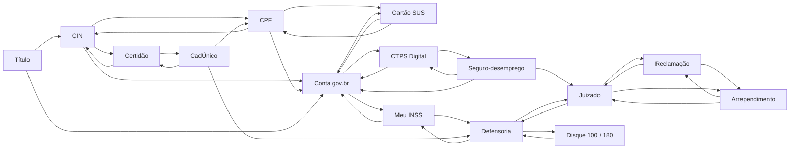

# Base de conhecimento — Citizen Assist AI

Este documento explica como a base de orientações (`data/base.json`) foi organizada, de onde vieram as informações e como mantê-la atualizada.

## 1. Visão geral

| Item | Valor |
|---|---|
| Arquivo | `data/base.json` |
| Formato | JSON (UTF-8) |
| Registros | 15 |
| Temas | 3 (Documentação, Serviços públicos, Direitos e orientação comunitária) |
| Subtemas | 12 |
| Ligações entre assuntos | 36 |
| Data da verificação | 17/11/2026 |

O arquivo tem três partes:

- **Metadados** (`versao`, `atualizado_em`, `aviso_geral`): informações gerais da base e o aviso de que o assistente **não é canal oficial**.
- **`temas`**: a hierarquia tema → subtemas, usada para montar o menu.
- **`registros`**: a lista de orientações.

## 2. Campos de cada registro

| Campo | Tipo | Obrigatório | Para que serve |
|---|---|---|---|
| `id` | texto | sim | Identificador único (`DOC01`, `SERV03`, `DIR05`). O prefixo indica o tema. |
| `tema` | texto | sim | Chave do tema (`documentacao`, `servicos`, `direitos`). |
| `subtema` | texto | sim | Chave do subtema dentro do tema. |
| `pergunta` | texto | sim | Pergunta principal que o registro responde. Também aparece no menu. |
| `palavras_chave` | lista | sim | Termos e sinônimos usados na busca, incluindo formas populares ("fui mandado embora", "perdi a certidão"). Ficam em minúsculas e sem acento para facilitar a comparação. |
| `orientacao` | texto | sim | Resposta resumida em linguagem simples. |
| `fonte` | texto | sim | Nome do órgão ou da lei de onde a informação veio. |
| `referencia` | texto (URL) | sim | Link verificável da fonte. |
| `data_verificacao` | texto (AAAA-MM-DD) | sim | Data em que a fonte foi conferida. |
| `requer_confirmacao` | true/false | sim | Quando `true`, o sistema mostra o aviso "confirme as regras atuais no canal oficial". É usado em orientações com prazos, valores ou regras que variam por estado ou município. |
| `observacao` | texto | não | Alerta extra (golpes, variações locais, outro link). |
| `relacionados` | lista de ids | sim | Assuntos ligados a este registro. Forma o grafo de navegação. |

## 3. Hierarquia de temas

```
Citizen Assist AI
├── Documentação (documentacao)
│   ├── Identificação ............ DOC01 CIN, DOC02 CPF
│   ├── Registro civil ........... DOC03 Segunda via de certidão
│   ├── Eleitoral ................ DOC04 Título de eleitor
│   └── Trabalho ................. DOC05 Carteira de Trabalho Digital
├── Serviços públicos (servicos)
│   ├── Acesso digital ........... SERV01 Conta gov.br
│   ├── Previdência .............. SERV02 Meu INSS
│   ├── Assistência social ....... SERV03 Cadastro Único
│   ├── Benefício trabalhista .... SERV04 Seguro-desemprego
│   └── Saúde .................... SERV05 Cartão do SUS
└── Direitos e orientação comunitária (direitos)
    ├── Consumidor ............... DIR01 Direito de arrependimento, DIR02 Reclamação contra empresa
    ├── Acesso à Justiça ......... DIR03 Defensoria Pública, DIR04 Juizado Especial Cível
    └── Proteção ................. DIR05 Disque 100 / Ligue 180
```

A hierarquia organiza o **menu**: o usuário escolhe o tema, depois o subtema e, por fim, a orientação.

## 4. Grafo de assuntos relacionados

Além da árvore, os registros se ligam pelo campo `relacionados`, formando um **grafo dirigido** (cada registro aponta para os próximos assuntos sugeridos). Assim o usuário pode ir de um tema para outro sem voltar ao menu.

As ligações seguem três critérios:

1. **Dependência**: um serviço exige outro documento ou serviço. Exemplo: a CIN exige a certidão de nascimento (DOC01 → DOC03), e o seguro-desemprego usa a Carteira de Trabalho Digital (SERV04 → DOC05).
2. **Próximo passo**: o que a pessoa costuma precisar em seguida. Exemplo: depois de desistir de uma compra, reclamar contra a empresa e, se não resolver, ir ao Juizado (DIR01 → DIR02 → DIR04).
3. **Mesmo problema, outra porta**: caminhos alternativos para a mesma necessidade. Exemplo: Defensoria e Juizado (DIR03 ↔ DIR04).



**Exemplo de navegação entre 3 ou mais assuntos** (requisito do enunciado):
Seguro-desemprego (SERV04) → Carteira de Trabalho Digital (DOC05) → Conta gov.br (SERV01) → Meu INSS (SERV02).

O grafo também liga temas diferentes. Por exemplo, Serviços → Direitos (SERV04 → DIR04) e Documentação → Serviços (DOC03 → SERV03).

## 5. Origem das informações e critérios das fontes

Cada orientação foi conferida em uma fonte identificável, com preferência nesta ordem:

1. **Portais oficiais** do governo (gov.br, TSE, INSS);
2. **Texto da lei** no site do Planalto (CDC, Lei 9.099/95, Constituição);
3. **Portais oficiais de serviço** mantidos por órgãos públicos ou delegatários (Portal do Registro Civil, Consumidor.gov.br).

As orientações foram **resumidas com palavras próprias**. Nenhum trecho foi copiado integralmente, e nenhuma informação foi incluída sem fonte.

| ID | Assunto | Fonte |
|---|---|---|
| DOC01 | CIN | MGI — gov.br |
| DOC02 | CPF | Receita Federal — gov.br |
| DOC03 | Segunda via de certidão | Portal do Registro Civil (ON-RCPN) |
| DOC04 | Título de eleitor | TSE — Título Net |
| DOC05 | Carteira de Trabalho Digital | Ministério do Trabalho e Emprego — gov.br |
| SERV01 | Conta gov.br | Secretaria de Governo Digital — gov.br |
| SERV02 | INSS | Meu INSS |
| SERV03 | Cadastro Único | MDS — gov.br |
| SERV04 | Seguro-desemprego | Ministério do Trabalho e Emprego — gov.br |
| SERV05 | Cartão do SUS | Ministério da Saúde — gov.br |
| DIR01 | Direito de arrependimento | CDC, art. 49 — Planalto |
| DIR02 | Reclamação contra empresa | Senacon — Consumidor.gov.br |
| DIR03 | Defensoria Pública | Constituição Federal, art. 5º LXXIV e art. 134 — Planalto |
| DIR04 | Juizado Especial Cível | Lei 9.099/95 — Planalto |
| DIR05 | Disque 100 / Ligue 180 | MDHC e Ministério das Mulheres — gov.br |

Os links completos estão no campo `referencia` de cada registro.

## 6. Como adicionar ou corrigir uma orientação

A base fica separada do código. Por isso, **adicionar ou corrigir orientações não exige mudar o programa**:

1. Abra `data/base.json`.
2. Copie um registro existente e cole no fim da lista `registros`.
3. Crie um `id` novo seguindo o prefixo do tema (ex.: `DOC06`).
4. Preencha os campos com informação **conferida na fonte** e atualize `data_verificacao`.
5. Se for um subtema novo, inclua-o em `temas → <tema> → subtemas`.
6. Ligue o registro a outros pelo campo `relacionados`.
7. Rode o validador:

```bash
python scripts/validar_base.py
```

O validador confere campos obrigatórios, ids duplicados, temas e subtemas inexistentes, links quebrados no grafo, formato da data e da referência, e os mínimos do enunciado (15 registros e 3 temas). Ele também trata arquivo ausente, vazio ou com JSON inválido.

## 7. Cuidados e limitações da base

- **Não é canal oficial.** O assistente só orienta e sempre indica a fonte oficial para confirmação.
- **As informações mudam.** Prazos, valores e regras podem ser alterados. Registros com `requer_confirmacao: true` mostram um aviso para o usuário confirmar no canal oficial.
- **Variações locais.** Regras de CIN, CadÚnico, certidões e Defensoria variam por estado ou município, e a base traz só a orientação geral.
- **Sem dados pessoais.** A base não guarda nenhum dado de usuário, apenas orientações públicas.
- **Revisão periódica.** A recomendação é reconferir todas as fontes a cada 6 meses ou antes de cada demonstração.
- **Escopo limitado.** São 15 orientações. Perguntas fora delas devem receber o aviso de que não há base suficiente, sem respostas inventadas.
